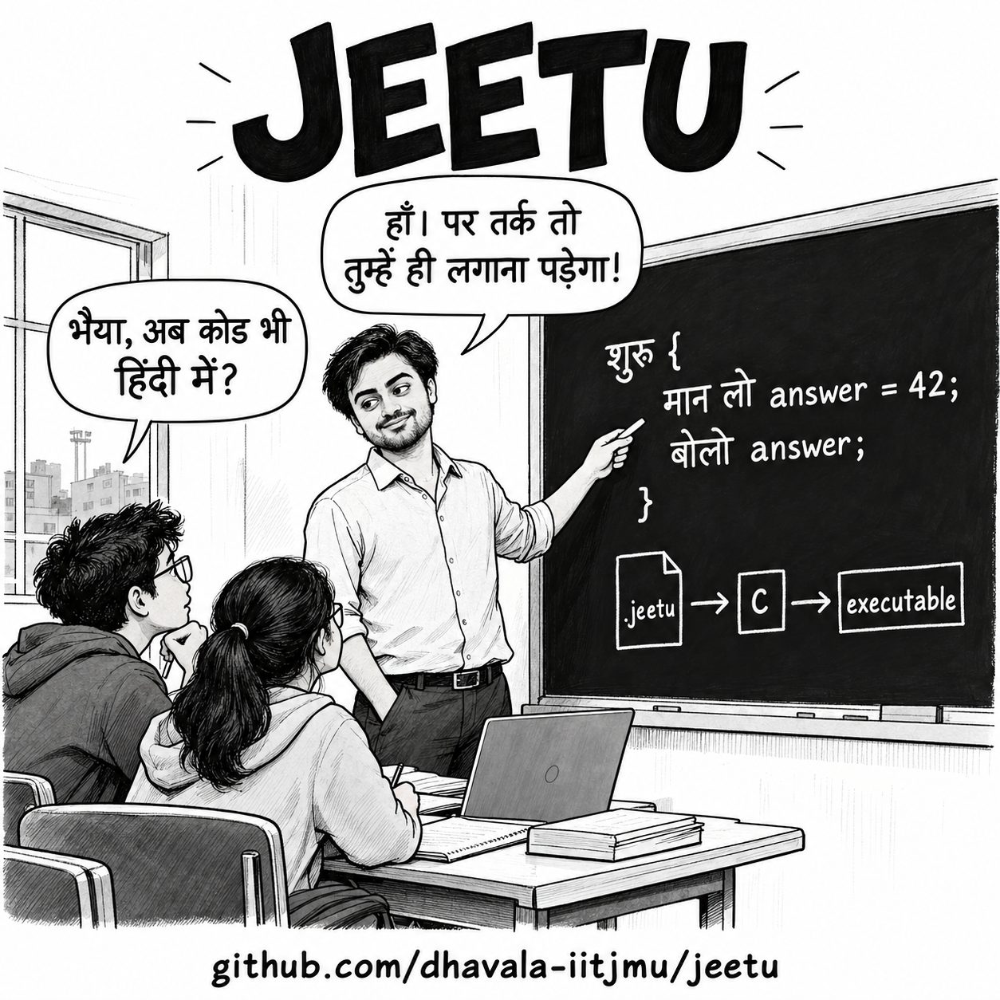

# Jeetu 0.1

A small educational language with Devanagari keywords and English names,
compiled through readable C11 to a native executable. The compiler requires
Python 3.9+ and a C11 compiler (`cc`, Clang or GCC); no Python packages are needed.
Generated executables do not require Python.

🎂 **Jeetu's birthday is 27 October.  Jeetu was born on **27 October 2026** at **9:33:37 PM IST (UTC+05:30)** on Apple Silicon.

> [!WARNING]
> **For education and experimentation only.** Jeetu is an experimental teaching
> project, not a production-ready language. Do not use it for serious work,
> production systems, or anything where correctness, security, or reliability
> matters. Bugs, limitations, and breaking changes should be expected.
> **Try it at your own risk.**
>
> Even better, use it as a starting point: study the compiler, report bugs,
> contribute tests and features, and help turn Jeetu into a full-fledged language.



## Try it

From the repository root:

```sh
python3 jeetu.py run examples/fibonacci-recursive.jeetu
```

Output: `55`.

```text
कार्य fib(n: पूर्णांक): पूर्णांक {
    अगर (n <= 1) {
        लौटाओ n;
    }
    लौटाओ fib(n - 1) + fib(n - 2);
}

शुरू {
    बोलो fib(10);
}
```

`कार्य` defines a function, `पूर्णांक` names the integer type, and `लौटाओ`
returns a value. `मान लो` declares a variable, `जब तक` repeats a block, and
`बोलो` prints with a newline. Language constructs use Devanagari exclusively;
variable and function names use ASCII English letters, digits and underscore.

## Build and inspect the C

```sh
mkdir -p build
python3 jeetu.py check examples/fibonacci-recursive.jeetu
python3 jeetu.py build examples/fibonacci-recursive.jeetu -o build/fibonacci-recursive
./build/fibonacci-recursive
```

`build` retains **`build/fibonacci-recursive.c`** and automatically compiles and links the
runtime. The C file preserves safe source names, contains ordinary function
definitions, and includes `jeetu_runtime.h`. Runtime implementations live in
[`runtime/`](runtime), rather than filling the generated program.

To emit C and compile it yourself:

```sh
python3 jeetu.py emit-c examples/factorial.jeetu -o build/factorial.c
cc -std=c11 -Wall -Wextra -Werror -pedantic \
   -I runtime build/factorial.c runtime/jeetu_runtime.c -o build/factorial
./build/factorial
```

For a **single independently compilable file**, explicitly embed the runtime:

```sh
python3 jeetu.py emit-c examples/factorial.jeetu --standalone -o build/factorial-standalone.c
cc -std=c11 -Wall -Wextra -Werror -pedantic \
   build/factorial-standalone.c -o build/factorial-standalone
./build/factorial-standalone
```

`--standalone` also works with `build` and `run`. Use `--cc clang` or `--cc gcc`
to select a compiler. Without `-o`, `emit-c` writes to stdout and `build` creates
`a.out` plus `a.out.c`. `run` compiles in a temporary directory and executes the
result. Build output paths append `.c` to the executable path; existing output
files are replaced, but build outputs cannot overwrite the source file.

## C feature compatibility (0.1)

Jeetu compiles to **C11**, but is not a C dialect and does not accept arbitrary
C syntax or libraries. The table maps familiar C features to what is available
in Jeetu source; implementation details hidden in the runtime are not additional
Jeetu language features.

| C feature | Jeetu support | Syntax or limitation |
| --- | --- | --- |
| Integer variables | Supported | `मान लो count = 5;` → `int64_t`; signed 64-bit only, with checked arithmetic |
| Boolean variables | Supported | `मान लो ready = सच;` → `bool`; no implicit integer-to-Boolean conversion |
| `char`, other integer widths, unsigned integers | Not supported | No separate character type, `short`, unsigned types, or selectable widths |
| `float`, `double` | Not supported | No floating-point arithmetic |
| Strings | Partial | Immutable UTF-8 `पाठ` values; indexing, length, assignment and function passing/return; not mutable C `char[]` strings |
| Local variables and block scope | Supported | Inferred, fixed types; initialization required; inner blocks may shadow names |
| Global/static variables and `const` declarations | Not supported | Variables are local; no storage-class or const qualifiers |
| Arithmetic and assignment | Supported | `+ - * / %`, unary `-`, and `=`; overflow and division by zero report errors |
| Comparisons and Boolean operators | Supported | `== != < <= > >=`, `&&`, `\|\|`, `!`; Boolean operators short-circuit |
| Bitwise operators, shifts, increment and compound assignment | Not supported | No `&`, `\|`, `^`, `~`, `<<`, `>>`, `++`, `--`, `+=`, etc. |
| `if` / `else` | Supported | `अगर (condition) { ... } वरना { ... }` |
| `while` | Supported | `जब तक (condition) { ... }`; nested loops supported |
| `for`, `do while` | Not supported | Use `जब तक` |
| `break`, `continue` | Supported | `रुको;`, `जारी;`; apply to the innermost loop |
| `switch`, `goto`, ternary `?:` | Not supported | Use branching and loops |
| Functions and `return` | Supported | `कार्य` and `लौटाओ`; explicit parameter/return types; every path must return |
| Recursion and forward calls | Supported | Includes mutual recursion; limited in practice by the native call stack |
| `void` functions, variadic functions, function pointers | Not supported | Functions return an integer, Boolean or text value |
| Arrays | Partial | Growable integer `सूची`: `[4, 9, -2]`, zero-based reads `values[i]`, `लंबाई(values)`; bounds checked |
| Array writes and multidimensional arrays | Not supported | No `values[i] = ...`, nested arrays or arrays of other element types |
| Dynamic array operations | Supported | `डालो`, `निकालो`, `आखिरी`, `खाली` provide push, pop, top and empty-test |
| Array/sequence parameters | Supported with borrowing | `values: सूची` shares caller-owned storage; mutations are visible; sequences cannot be copied or returned |
| Structs, unions, enums, typedefs | Not supported | Runtime C structs are internal representations, not Jeetu constructs |
| Pointers and address operations | Not supported in source | No address-of, dereferencing or pointer arithmetic; generated C may use pointers internally |
| Dynamic memory allocation | Automatic only | Sequences grow as needed and are freed when their owning scope exits, including return/break/continue |
| Explicit `malloc` / `free` | Not supported | Allocation and cleanup belong to the runtime/compiler |
| Console output | Supported | `बोलो` adds a newline; `लिखो` does not; prints integers, Booleans and text |
| Keyboard input and file I/O | Not supported | No `scanf`, file handles, open/read/write/close or equivalent operations |
| Preprocessor, headers and C-library calls | Not supported in source | No `#include`, macros or arbitrary C interoperation; generated C links the Jeetu runtime |

Unlike C, Jeetu specifies left-to-right expression evaluation, checks arithmetic
and array bounds, and does not expose raw memory. Scalars and immutable text
pass by value; sequences are borrowed by reference. Text indices count Unicode
code points rather than bytes or grapheme clusters. Text concatenation is not
implemented.

## Examples and learning material

[The example guide](examples/README.md) lists **14 runnable programs**, concepts,
expected output and exercises: recursive/iterative Fibonacci, maximum, reversal,
prime testing, search, filtering, binary conversion, recursion, GCD and a tape
simulation. Every `.jeetu` file has a matching `.expected` output file.

- [Specification](docs/spec.md): grammar, types, ownership, evaluation and errors.
- [Compiler workflow](docs/workflow.md): implementation and generated C explained.
- [Turing completeness](docs/turing-completeness.md): constructive two-stack argument.
- [Development goals](goal.md): project purpose and next steps.

Run verification:

```sh
python3 -m unittest discover -s tests -v
SANITIZE=1 python3 -m unittest discover -s tests -v
CC=gcc python3 -m unittest discover -s tests -v
```

MIT licensed. Independent educational project inspired by Hinglish programming
and a patient teacher's tone; no affiliation or endorsement is implied.
